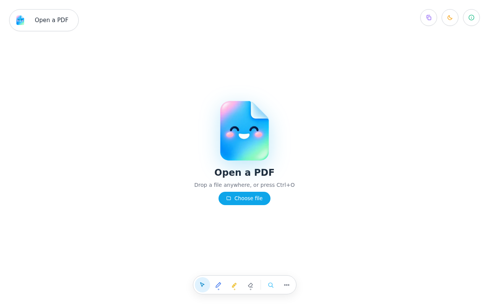
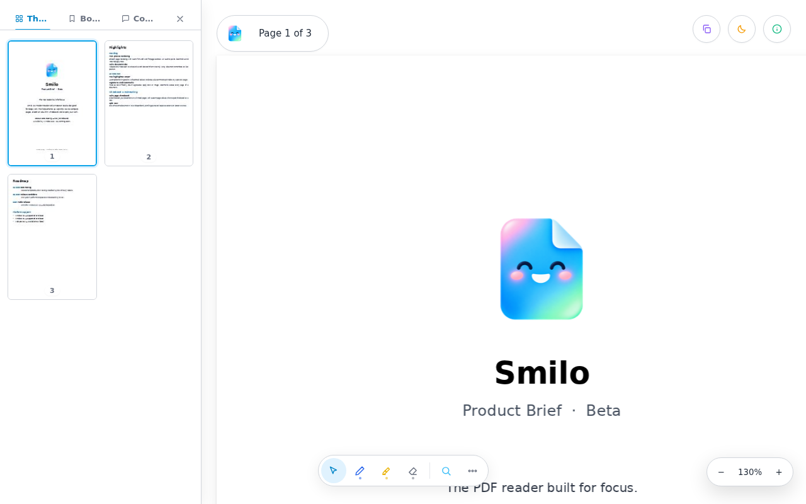
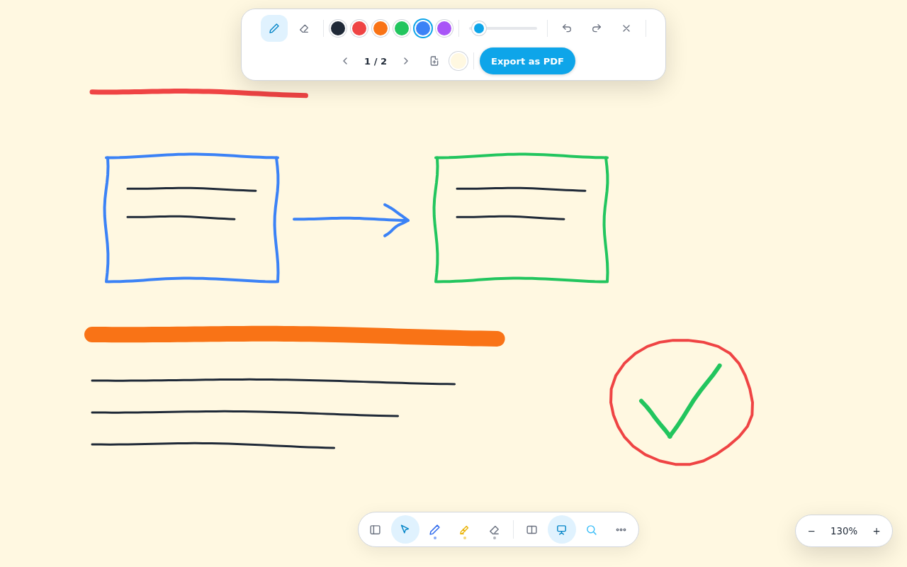
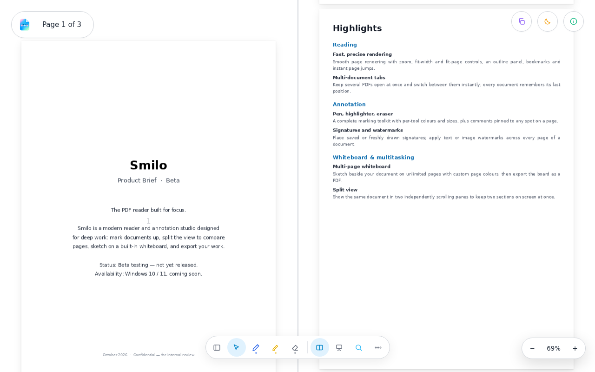
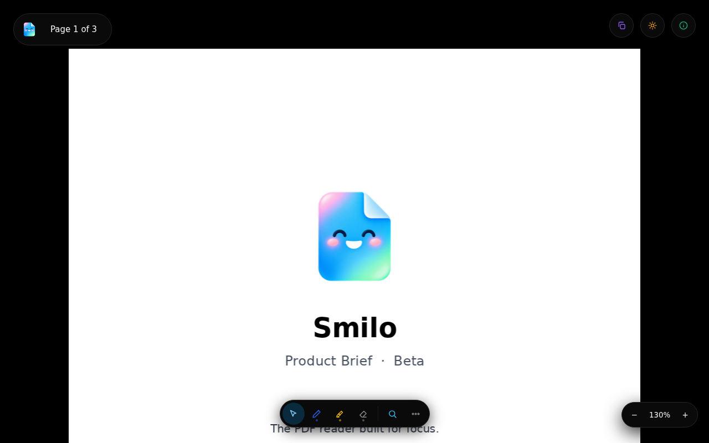
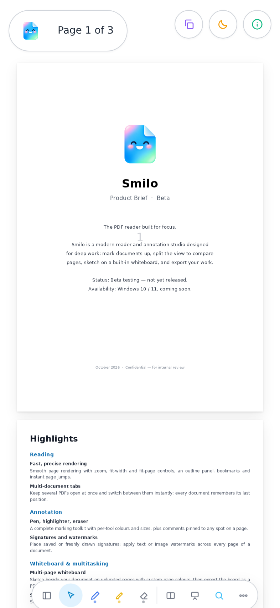

# Smilo

### The PDF reader built for focus.

A modern PDF reader and annotation studio — read, mark up, split, sketch, and export.

---

## Overview

Smilo is a fast, thoughtfully designed PDF reader with a complete annotation toolkit at its heart. Open documents in tabs, mark them up with pen and highlighter, split the view to keep two sections of a document on screen, brainstorm on the built-in multi-page whiteboard, and export your work — all in a clean interface that stays out of your way.

> **Beta notice** — Smilo is currently in **beta testing** and has **not been released yet**. It is **coming soon, exclusively for Windows 10/11**.

## Live demo

Try the full experience right in your browser — open any PDF from your device and explore:

| | |
|---|---|
| **[Open the beta demo →](https://comet-suite.github.io/smilo-pdf-viewer/)** | The current beta build — the beta notice is shown on launch |

> [!WARNING]
> **Do not upload private or sensitive documents.** Never open personal files in the web demo — identity cards, passports, bank statements, tax or medical records, contracts, or anything containing personal data. Try Smilo with non-sensitive documents only — until the full Windows version comes.

## Screenshots

  

<table>
  <tr>
    <td align="center"></td>
    <td align="center"></td>
  </tr>
  <tr>
    <td align="center"><b>Reader</b> — thumbnails, outline and a precise tool dock</td>
    <td align="center"><b>Whiteboard</b> — multi-page sketching with custom page colours</td>
  </tr>
  <tr>
    <td align="center"></td>
    <td align="center"></td>
  </tr>
  <tr>
    <td align="center"><b>Split view</b> — the same document, two independent panes</td>
    <td align="center"><b>Dark mode</b> — easy on the eyes, day or night</td>
  </tr>
</table>

  
   
  <b>Touch mode</b> — a floating dock and gestures, built for fingers

## Features

### Reading
- Smooth page rendering with precise zoom, fit-width and fit-page controls
- Multi-document tabs — keep several PDFs open and switch instantly
- Page thumbnails with a sharp quick-preview on long-press
- Document outline, bookmarks and instant page jump
- Text selection with touch-friendly handles; search with match navigation
- Your reading position is remembered for every document

### Annotation
- Pen, highlighter and eraser with per-tool colours
- Comments pinned to any spot on a page
- Signature tool
- Text and image watermarks across every page
- One-tap removal of all annotations

### Whiteboard
- Built-in multi-page whiteboard alongside your document
- Custom page colours — presets or any colour you choose
- Full drawing toolkit: colours, stroke size, eraser, undo/redo, clear
- Export the entire board as a PDF

### Multitasking & touch
- Split view — the same document in two independently scrolling panes
- Touch mode with a floating tool dock
- Gestures: long-press to move the dock, one-finger rotation to snap it back to centre
- Quick-scroll circle and pinch zoom
- Dark mode, page invert, repositionable dock

## Availability

| Platform | Status |
|---|---|
| Windows 10 | Coming soon |
| Windows 11 | Coming soon |
| Web demo | Available now — beta |

Smilo is in **beta testing** and is **not yet released**. The desktop application will be available **for Windows 10/11 only**.

## Status

**Beta** — actively in testing. The live demo in this repository reflects the current beta build.

## Feedback

Found a rough edge or have an idea? [Open an issue](https://github.com/Comet-Suite/smilo-pdf-viewer/issues) — beta feedback directly shapes the release.

---

Smilo · All rights reserved.

